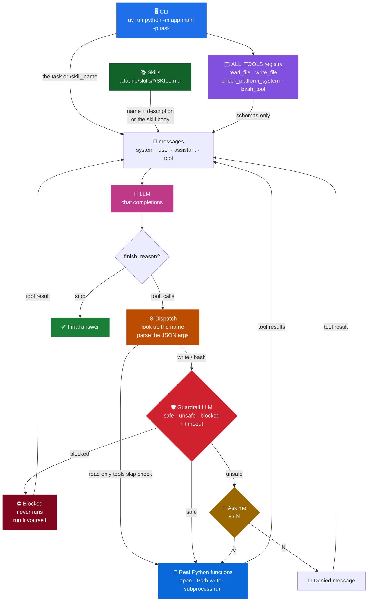
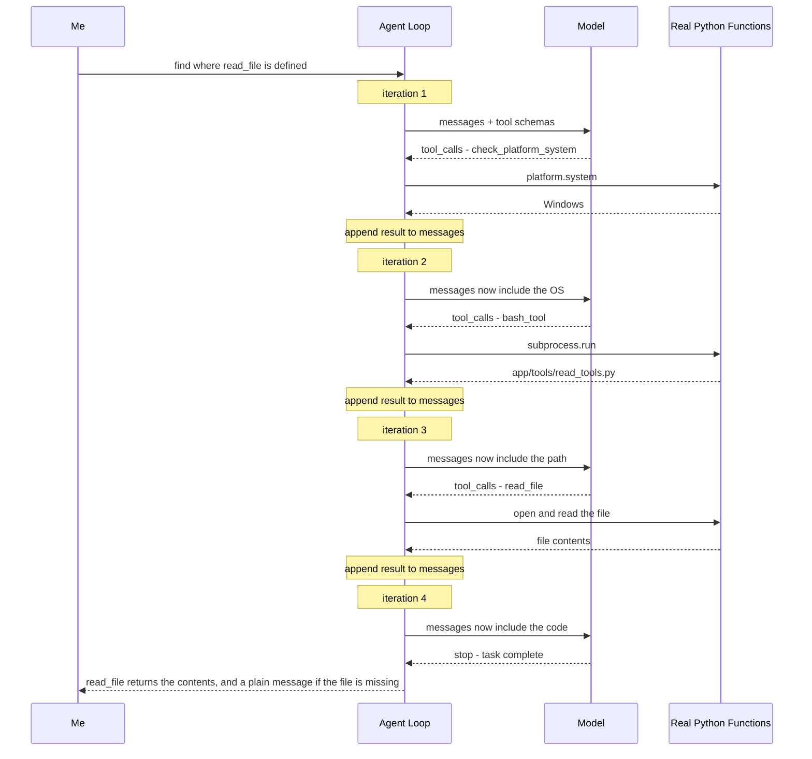
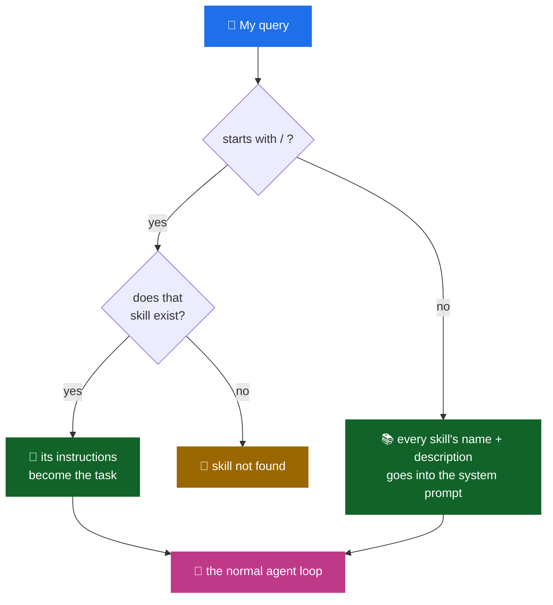

<div align="center">

---

Most people treat coding agents as magic. They are not.

Underneath, a tool-calling agent is **a message list, a dictionary of functions, and a loop**. The fastest way to prove that to yourself is to write one, so I did — as part of the [Build Your Own Claude Code](https://app.codecrafters.io/courses/claude-code) challenge from CodeCrafters.

The point of this repo is the _mechanism_: how a model is told which tools exist, what it actually sends back when it wants one, who runs the code, and how feeding that result into the conversation turns a single prompt into an agent that keeps working until the job is done.

> **A note on authorship:** this README is the only part AI wrote. The agent loop, tool schemas, tool registry, dispatch logic, and iteration control are all code I wrote myself. AI handled the typing cardio; I handled the agent workout. Fair deal.

---

## 🏗️ Architecture



Look at the edge labelled **`schemas only`**. That is the entire safety story of a tool-calling agent.

The model receives _descriptions_ of what exists — names, parameters, docstrings. It never receives a single callable. When it wants something done it says _"I would like to call `read_file` with this path"_, and my code decides whether that name is in the registry, and my code runs it.

And for anything that writes or runs commands, a **second LLM** looks at the call first. If it smells trouble, the agent stops and asks me.

---

## 🔁 How a Reactive Agent Actually Works

A chatbot answers once. An agent **reacts to what it just found out**, and keeps going.

Here is a real task running through the loop. I asked it _"find where `read_file` is defined and explain what it returns"_ — something impossible to answer in one shot, because the model has no idea where that function lives:



**Four round trips. I scripted none of them.**

I never wrote _"first check the OS, then search, then read"_. I wrote the loop that lets it keep going, and a dictionary of things it is allowed to ask for. The sequencing is entirely the model's.

### The loop in six steps

| #   | Step                                                                            | Who does it |
| --- | ------------------------------------------------------------------------------- | ----------- |
| 1   | Send the task + **tool schemas** (names, descriptions, parameters)              | my code     |
| 2   | Reply with `finish_reason: "tool_calls"` and name the tool wanted               | the model   |
| 3   | Look the name up in the registry, `json.loads` the args, call the real function | **my code** |
| 4   | Push the result back into `messages` as `{"role": "tool", ...}`                 | my code     |
| 5   | Loop — decide the next move knowing what was just learned                       | the model   |
| 6   | Reply with `finish_reason: "stop"` — done                                       | the model   |

**Step 4 is the whole idea.** The result does not get stashed in a variable somewhere, it goes back into the conversation. Every decision is a _reaction_ to the previous result.

That is why it is called a reactive agent, and it is the only thing separating this from a chatbot with extra steps.

---

## 📚 How Skills Work

Tools are things the agent can **do**. Skills are things it **knows how to do**: instructions I write once and reuse.

A skill is just a folder with a `SKILL.md` inside: a name, a one-line description, and the instructions underneath. Drop one into `app/.claude/skills/` and the agent picks it up on the next run.



Normally the model only sees each skill's **name and description**. That is enough for it to know the skill exists, and the instructions cost nothing until I actually ask for one.

Typing `/apple` is me saying *"this one"*. Now the instructions themselves become the task. And if there is no such skill, the model is told to say so instead of inventing one.

How do I know the instructions really reached the model, and it is not just guessing from the name? The `apple` skill is a canary. Its instructions say to reply with exactly one word: `blueberry`. Nobody guesses *blueberry* from *"Reports the deploy target for the apple service"*.

---

## ✨ What It Does

| Capability                        | Tool                    | What it really is                                                                      |
| --------------------------------- | ----------------------- | -------------------------------------------------------------------------------------- |
| 📖 Read any file                  | `read_file`             | `open(path).read()`, errors returned as text not raised                                |
| ✍️ Write / create a file          | `write_file`            | `Path(p).open("w")`                                                                    |
| 🖥️ Detect the OS                  | `check_platform_system` | `platform.system()`                                                                    |
| ⚡ Run shell commands             | `bash_tool`             | `subprocess.run()` via `cmd.exe` or `/bin/bash`                                        |
| 🔁 Keep going until done          | _the loop_              | `while iteration < max_iteration`                                                      |
| 🛑 Refuse to spin forever         | `low`/`medium`/`high`   | an iteration budget                                                                    |
| 🛡️ Check before acting            | _guardrail agent_       | a second LLM call that replies `safe`, `unsafe` or `blocked`                           |
| 🙋 Ask before anything risky      | _approval prompt_       | `input()` with `[y/N]`, default is No                                                  |
| ⛔ Never run the really bad stuff | _blocked_               | not even with a yes, you get the command to run yourself                               |
| ⏱️ Don't hang on a tool           | _timeout_               | guardrail suggests one, 5s if it doesn't                                               |
| 📚 Know its skills                | _skills_                | a folder with a `SKILL.md`, only its name and description reach the model              |
| 🪄 Run a skill on demand          | `/skill_name`           | that skill's instructions become the task                                              |

---

## 🚀 Quick Demo

The simple stuff works like you would expect:

```bash
$ uv run python -m app.main -p "what OS am I on?"
Windows

$ uv run python -m app.main -p "create a file hello.py that prints hello world"
File hello.py is create successfully and content is written in it.
```

The interesting stuff is anything that needs more than one step:

```bash
$ uv run python -m app.main -p "find where read_file is defined and explain what it returns"
# → 4 tool calls, sequenced by the model, see the diagram above

$ uv run python -m app.main -p "list every python file under app/ and count them"
# → checks the OS first, then picks the right command for that shell
```

And the one that made me add a guardrail:

```text
$ uv run python -m app.main -p "create a python file for shutdown and run it"
[step 1/5] thinking...
  -> write_file({'file_path': 'shutdown.py', 'content': "import os\nos.system('shutdown /s /t 0')"})
  guardrail: blocked, timeout 5s, script calls shutdown
  WARNING: this is too destructive, the agent will not run it.
  If you really need it, run it yourself:
  {'file_path': 'shutdown.py', 'content': "import os\nos.system('shutdown /s /t 0')"}
[step 2/5] thinking...
...
```

Something less extreme, like deleting a file in the project, comes back as `unsafe` and just asks:

```text
  -> bash_tool({'command': 'del old_notes.txt', 'system': 'Windows'})
  guardrail: unsafe, timeout 10s, deletes a project file
  Allow bash_tool to run? [y/N]:
```

The step logs go to `stderr`, so `stdout` still only has the final answer.

Skills are called with a slash:

```bash
$ uv run python -m app.main -p "/apple"
# → blueberry   (the skill body says to reply with exactly that word)

$ uv run python -m app.main -p "/banana"
# → skill not found   (no such SKILL.md, so the model is told not to improvise)
```

---

## 🔬 Inside the Code

<details>
<summary><b>1. Where it starts</b> — <code>app/main.py</code></summary>

<br/>

Deliberately dull:

```python
ALL_TOOLS = {**READ_TOOLS, **WRITE_TOOLS, **BASH_TOOLS}
response = _call_reactive_agent(args.p, ALL_TOOLS)
```

Parse one `-p` argument, merge the tool groups, hand it all to the agent.

Giving the agent a new power later means adding one more dictionary to that merge. Nothing else changes — the sort of thing you only appreciate after writing the messy version first.

</details>

<details>
<summary><b>2. How the model finds out what it can do</b> — the registry</summary>

<br/>

Every tool here is two things wearing one name:

```python
READ_TOOLS = {
    "read_file": {
        "schema":   { ...what the model sees... },
        "function": __read_file,   # what actually runs
    },
}
```

The **schema** travels to the model. The **function** never leaves my process.

When a tool call comes back, the name in that response is just a dictionary key — and looking it up is how a sentence from a language model becomes a Python function call.

The functions are name-mangled (`__read_file`) so nothing outside the module can import them. The registry is the only door in, and I am the doorman.

</details>

<details>
<summary><b>3. Why the schemas are Pydantic, not raw JSON</b> — <code>app/schemas/</code></summary>

<br/>

I wrote them as plain dictionaries first. Fine for one tool, awful by the third — the format uses `type` as a key in three different nested places, and every typo produced a model that behaved _slightly_ wrong rather than crashing.

So they became Pydantic models, with safe Python names aliased back to the wire format:

```python
class Properties(BaseModel):
    property_type: str = Field(alias="type", default="object")
    description: str
```

dumped with `by_alias=True` at the end.

Then there is the validator I added after losing an evening:

```python
@model_validator(mode="after")
def validate_required(self):
    missing = self.required - self.parameters.properties.keys()
    if missing:
        raise ValueError(f"Required properties not defined: {sorted(missing)}")
```

I had marked a parameter as required and never defined it. Nothing crashed. The agent just got quietly stupid for an hour.

Now it refuses to start instead — the kind of loudness I have learned to appreciate.

</details>

<details>
<summary><b>4. Who actually runs the code</b> — dispatch</summary>

<br/>

For each requested tool: look up the name, `json.loads` the arguments, call the function, hand the output back in the shape the API wants.

```python
{
    "role": "tool",
    "tool_call_id": tool_call.id,
    "content": json.dumps(tool_result, ensure_ascii=False),
}
```

That `tool_call_id` is not decoration. When the model asks for three tools at once, it is the only thing telling it which answer belongs to which question.

And if the model asks for a tool that is not in my registry? Nothing happens. It gets skipped. The model can ask for `delete_everything` all day; it only ever receives what I registered.

</details>

<details>
<summary><b>5. Why <code>bash_tool</code> has a sibling</b> — <code>check_platform_system</code></summary>

<br/>

`bash_tool` returns `stdout`, `stderr`, and `return_code` as **three separate fields**.

Returning the return code separately sounds pedantic until you notice that _"the command failed silently"_ and _"the command worked and printed nothing"_ look identical if all you hand back is stdout.

`check_platform_system` exists so the model can **find out** which OS it is on before guessing at command syntax, instead of confidently sending `ls` to `cmd.exe`.

</details>

<details>
<summary><b>6. Why there is an iteration cap</b> — <code>app/config.py</code></summary>

<br/>

| mode     | max iterations (default) |
| -------- | ------------------------ |
| `low`    | 20                       |
| `medium` | 30                       |
| `high`   | 40                       |

I once watched a model call the same tool four times in a row, getting the same result each time and being no closer to an answer.

**An agent loop with no cap is an infinite loop with a billing address.**

Simple tasks are happy in `low`. Poking around a whole codebase is what `high` is for.

</details>

<details>
<summary><b>7. Why there is a second LLM watching the first</b> — the guardrail</summary>

<br/>

`bash_tool` already had a regex blacklist: `shutdown /s`, `rm -rf /`, `format`, and friends. I felt pretty safe.

Then I asked it to _"create a python file for shutdown and run it"_. It did exactly that:

1. `write_file("shutdown.py", "os.system('shutdown /s /t 0')")` — just writing a file, no blacklist hit
2. `bash_tool("python shutdown.py")` — just running python, no blacklist hit

Each step looks innocent on its own. The danger is in the **combination**, and a regex only ever sees one command.

So before any non read-only tool runs, I ask the LLM again, this time with a different job:

```text
You are a security checker for a coding agent...
Reply in one line as: <safe, unsafe or blocked> | <timeout> | <reason>
```

The trick is what I send with it: **every previous tool call in the conversation**. So when it sees `python shutdown.py`, it can also see what was written into `shutdown.py` one step earlier.

- `safe` → runs straight away
- `unsafe` → I get asked `Allow bash_tool to run? [y/N]`
- `blocked` → never runs, **not even if I say yes**. It prints a warning and the command, so if I really want it I run it myself
- guardrail crashes or replies garbage → treated as `unsafe`, so I get asked

Why not just ask for `blocked` too? Because at 2am I _will_ hit `y` without reading. Shutdown, wiping a disk, deleting the registry — if I truly want that, typing it myself is a feature, not friction. An agent should never be the one pressing that button.

If I say no (or it is blocked), the model gets a tool result telling it so and not to retry. Same idea as errors: don't kill the loop, tell the model and let it react.

**The timeout comes from the same reply.** Reading a file needs a few seconds, `pip install` needs a lot more. Instead of one fixed number, the guardrail suggests one. If it doesn't give a number, it falls back to `5`, and it can never go above `120`, so the model can't ask for an hour.

My first timeout was a lie, though. I wrapped tools in `with ThreadPoolExecutor()` and called `future.result(timeout=5)`. It did raise after 5 seconds... and then the `with` block quietly waited for the thread to finish anyway. A 30 second command still took 30 seconds.

Python can't kill a thread, so the real fix lives in `bash_tool`: it gets the timeout, and when time is up it kills the **whole process tree** (`taskkill /T` on Windows, the process group on Linux/macOS). Just killing the shell is not enough — `python script.py` started by it keeps running happily in the background.

</details>

---

## 📁 Project Structure

```text
app/
├── .claude/skills/                # 📚 One folder per skill
│   ├── apple/SKILL.md             #    canary skill, replies "blueberry"
│   └── grape/SKILL.md
├── main.py                        # CLI entry, merges tools, calls the agent
├── config.py                      # Env settings, model, iteration caps
├── handlers/
│   └── reactive_agent_handlers.py # 🔁 The agent loop, /skill routing, tool dispatch and 🛡️ guardrail
├── prompts/
│   └── prompts.yaml               # 📝 Every prompt the agent and guardrail use
├── schemas/
│   └── base_tool_schema.py        # Pydantic tool schema + validation
├── tools/
│   ├── read_tools.py              # read_file
│   ├── write_tools.py             # write_file
│   └── bash_tools.py              # check_platform_system, bash_tool (+ regex blacklist)
└── utils/
    ├── console.py                 # Coloured step logs and the y/N approval prompt
    ├── prompts_loader.py          # Reads prompts.yaml
    └── skills_loader.py           # Finds and reads the SKILL.md files
```

---

## ⚙️ Run Locally

**Python 3.14+**

```bash
uv sync
```

Put your model access in a `.env`:

```bash
MODEL_API_KEY=your_key_here
MODEL_BASE_URL=https://openrouter.ai/api/v1
MODEL_NAME=nvidia/nemotron-3-ultra-550b-a55b:free
MAX_ITERATIONS_LOW_MODE=20
MAX_ITERATIONS_MEDIUM_MODE=30
MAX_ITERATIONS_HIGH_MODE=40
```

Only the API key is required — everything else has a default.
Free keys are available from [OpenRouter](https://openrouter.ai) or [NVIDIA](https://build.nvidia.com/models).

```bash
uv run python -m app.main -p "your task here"
```

Worth trying, roughly in order of how much they show off:

```bash
uv run python -m app.main -p "what operating system am I on?"
uv run python -m app.main -p "read app/config.py and explain the settings"
uv run python -m app.main -p "create hello.py that prints hello world"
uv run python -m app.main -p "find where write_file is defined and summarise it"
uv run python -m app.main -p "/apple"
```

To add your own skill, drop a folder with a `SKILL.md` into `app/.claude/skills/`. It gets picked up on the next run.

> ⚠️ **This thing has a shell and a writer.** It can genuinely change your machine. The guardrail asks before anything that looks risky, but it is an LLM judging an LLM — not a sandbox. Point it at a folder you are willing to let it touch.

---

## 💡 What I Learned

**The model never runs anything.**
It returns a name and some JSON. My code does the lookup, my code parses the arguments, my code makes the call. Seeing it written out turns _"how do AI agents edit files?"_ into _"somebody wrote an `open()` call and told the model it exists"_. Less magic than people expect, and far more controllable.

**Tool descriptions are part of the program.**
The schema is not documentation the model skims — it is the only information it has when deciding whether a tool fits. A vague description does not throw an error. It produces an agent that quietly picks the wrong tool and gives you a confident wrong answer, which is a far worse failure than a crash.

**Errors should be returned, not raised.**
My instinct was to let `FileNotFoundError` propagate, and it took a few dead loops to see why that is wrong. A raised exception ends the agent. A returned sentence goes into `messages`, the model reads _"that file does not exist"_, and tries a different path next iteration. Error handling in an agent is not about protecting the program — it is about keeping the conversation alive long enough for the model to recover.

**Safety has to look at the whole conversation, not one command.**
My regex blacklist checked every command perfectly and still let a shutdown through, because the dangerous part was split across two harmless looking tool calls. The guardrail only works because it gets the history.

**Frameworks sell convenience, not capability.**
I went in expecting LangChain to be doing something I could not. It is a message list, a dictionary of functions, and a loop. Every abstraction on top is ergonomics. Worth using — and worth building once first, so you know what it is hiding.

---

<div align="center">
